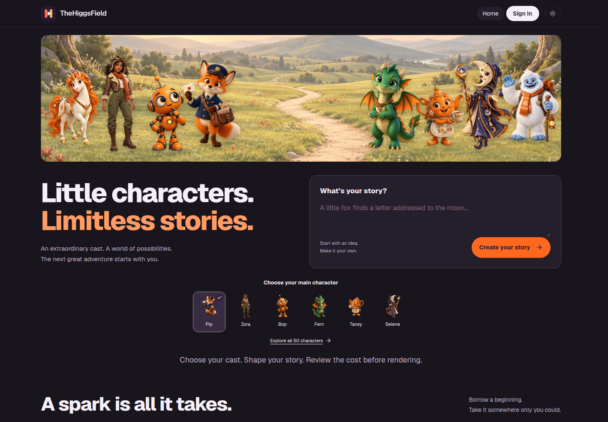
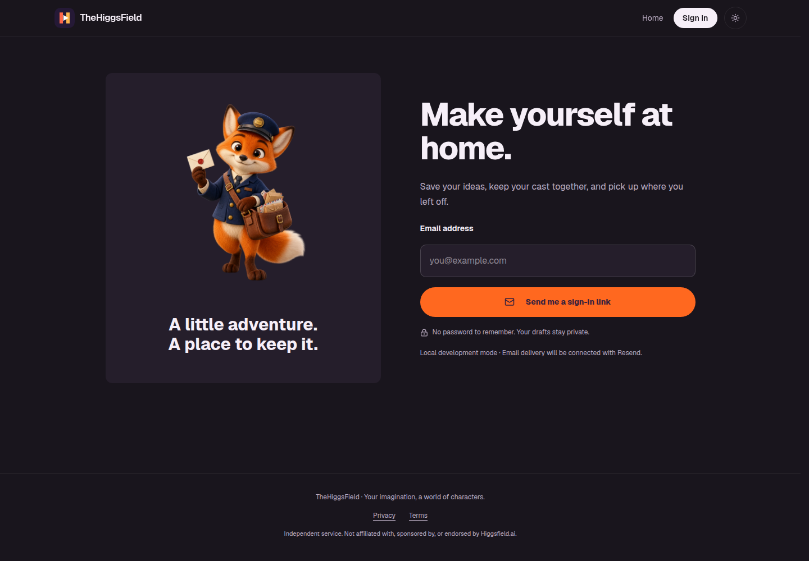
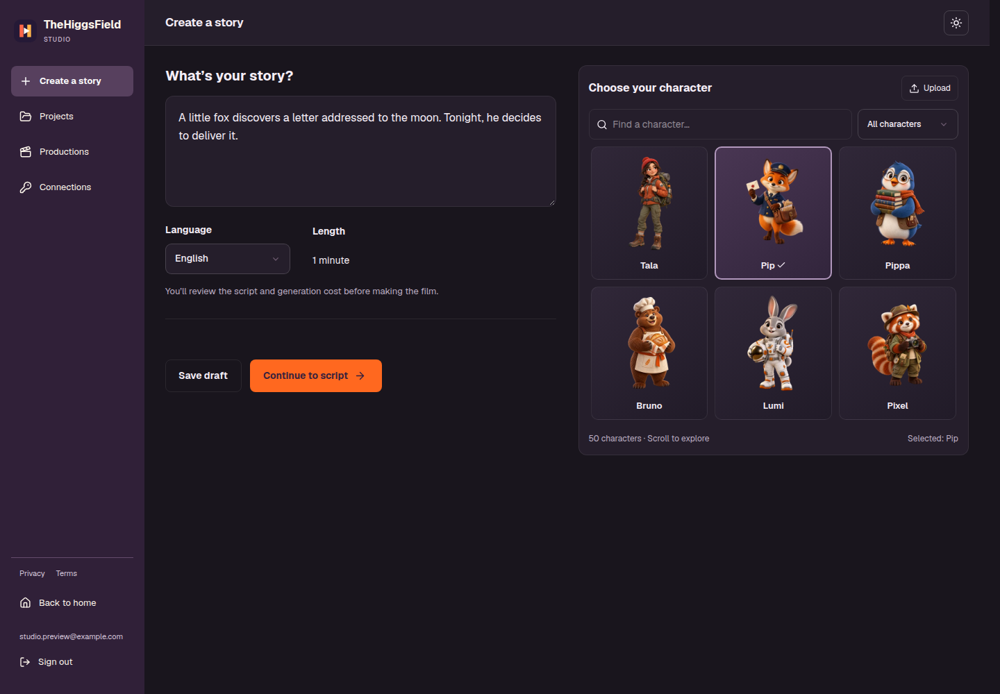
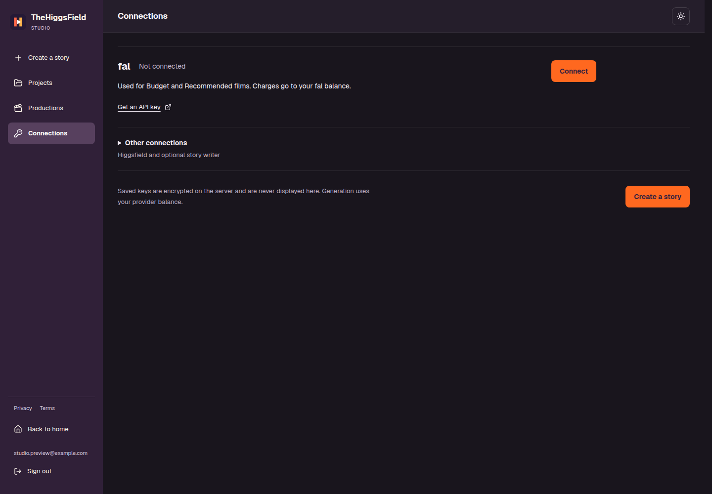
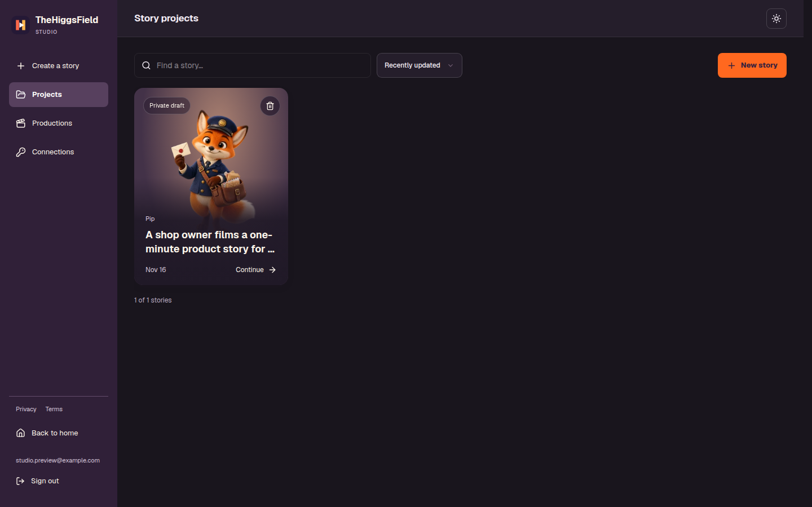

# OpenHiggsfield by Transformaiton.com

OpenHiggsfield is a self-hosted studio for one-minute character films. You choose a character, write the story, review six scenes and a cost estimate, then render with API keys from your own provider accounts. [Transformaiton.com](https://transformaiton.com/) publishes this copy for small businesses that want the tool on infrastructure they control.

The software is free under the MIT License. Rendering, optional script writing, sign-in email, and the computer you host it on are billed by those providers and by your host.

Transformaiton.com is not affiliated with, sponsored by, or endorsed by Higgsfield or Higgsfield.ai. Provider names and trademarks belong to their owners.



*Home page from a local run of this repository on 16 November 2026. The dark theme follows the system setting. No provider was called. The interface still shows the upstream name TheHiggsField.*

## What it does

- Browse 50 included characters, or upload your own PNG, JPG, or WebP image (up to 8 MB).
- Write a one-minute story in English, French, Hindi, Tamil, or Telugu.
- Review a six-scene script (10 seconds each), the voice direction, and an estimate before anything is sent to a provider.
- Connect fal, Higgsfield, and, if you want help drafting the script, OpenRouter. Keys are stored encrypted on your server.
- Render scene clips, assemble them with FFmpeg, and download a 720p MP4 (16:9).
- Keep private drafts and finished films in an account on your installation. Sign-in is an email link.

This release is the character story studio. The earlier general editor was removed upstream; Git history still has it. Public gallery publishing and private share links are not a finished distribution workflow. Voice identity and character consistency depend on the model you select. Read the script and watch the file before you publish it.

## Small-business uses

Each film is about 60 seconds, six scenes, widescreen, with narration generated by the video model. That shape fits a short marketing piece you can review before you spend:

- **Ads.** A one-minute spot for a service, a seasonal offer, or an event, told by a character you choose or by artwork you upload.
- **Social video.** A 720p MP4 you can post or embed. The studio does not publish to social networks for you.
- **Product promos.** Six scenes that introduce a product, show the problem, and end on a clear next step. Upload a character image when the included cast is the wrong fit. The model receives that image as a reference; it does not guarantee a perfect likeness.
- **Explainers.** A short walk-through of how a booking, class, or repair works, in one of the five story languages.

Save the draft and edit the words yourself at no provider charge. A render spends the connected account. Make one approved version, then decide whether a second render is worth another charge.

## Requirements and costs

You need:

- A computer with [Node.js 24](https://nodejs.org/) or newer and [FFmpeg](https://ffmpeg.org/) on `PATH`, or Docker with Docker Compose.
- An HTTPS name when anyone reaches the studio from outside your own machine. `localhost` and `127.0.0.1` are the local exceptions.
- A [Resend](https://resend.com/) API key and a From address Resend will send, for any installation that is not the local test server. The hosted sign-in screen sends one email link. It does not show a password field or a Google button.
- A funded account at the provider you will actually render with.

| Piece | Who bills you | What this release uses it for |
| --- | --- | --- |
| This repository | Nobody. MIT license. | The studio itself |
| Your server or laptop | Your host, if you pay for one | Docker or Node, disk, backups |
| [fal](https://fal.ai/dashboard/keys) | fal | Budget, Recommended, and Seedance renders |
| [Higgsfield](https://console.higgsfield.ai) | Higgsfield | Seedance renders, with a separate balance |
| [OpenRouter](https://openrouter.ai/settings/keys) | OpenRouter | Optional script writing with Gemini 2.5 Flash |
| [Resend](https://resend.com/) | Resend | Sign-in email on a hosted install |

Estimates stored in this release, checked in the source on 25 September 2026. They were not re-quoted from the providers for this guide. One new 60-second film, six 10-second clips with audio, before discounts:

| Option | Where | Model | Estimate |
| --- | --- | --- | --- |
| Budget | fal | MiniMax H3 Max, 480p source | $3.00 |
| Recommended | fal | MiniMax H3 Max, 768p source | $4.80 |
| Seedance 2.0 | fal or Higgsfield | Seedance 2.0, 720p | $18.14 |

Lower-resolution footage is scaled into the 720p file. Higgsfield is offered only for Seedance 2.0. A second render is another charge. The optional writer is a separate OpenRouter request and replaces all six scenes; writing the script yourself does not call OpenRouter.

The studio shows the estimate and waits for an explicit approval before it sends the script and the character image. The provider invoice can still differ. These figures are planning numbers from `deploy/story/films.mjs`.

**Current limit:** that file dates the price check 25 September 2026 and refuses a render once the check is more than 30 days old. On 16 November 2026 a local run stopped at the script step with “The video price needs to be refreshed before production.” Browsing, sign-in, and drafts still work. Refreshing the check is an application change and is outside this documentation update. Confirm a live rate on the provider’s page before you treat any figure above as a client quote.

Provider pages linked from the code:

- [fal MiniMax H3 Max reference-to-video](https://fal.ai/models/minimax/h3-max/reference-to-video)
- [fal Seedance 2.0 reference-to-video](https://fal.ai/models/bytedance/seedance-2.0/reference-to-video)
- [Higgsfield Seedance 2.0 playground](https://open.higgsfield.ai/models/bytedance/seedance-2.0/reference-to-video/playground)

## Quick start

This path runs the studio on your machine and signs you in without sending email or calling a paid API. It is the setup used for the screenshots in this repository.

```sh
git clone https://github.com/Transformaiton/OpenHiggsfield.git
cd OpenHiggsfield
node -v   # v24 or newer
npm ci
npm ci --prefix apps/story-studio
npm run dev
```

In a second terminal, from the same directory:

```sh
npm --prefix apps/story-studio run dev
```

Open <http://127.0.0.1:5193>. Choose **Sign in**, enter an email address, and use **Open local test sign-in**. The link stays on that page. Nothing is mailed. Test sign-in works only for this local development server.



Full install, Docker, and a public host: [docs/INSTALL.md](docs/INSTALL.md). Day-to-day use: [docs/USAGE.md](docs/USAGE.md).

## Screenshots

Create a story, pick a character, and save a draft before any provider call:



Connect fal when you are ready to render. Higgsfield and the optional writer sit under **Other connections**:



A saved draft stays in Projects. Deleting the draft leaves any finished film in place.



## Troubleshooting and FAQ

**The screen says TheHiggsField.** The application name in the interface is still the upstream name. This copy’s title for customers is OpenHiggsfield by Transformaiton.com. Sign-in email uses `APP_NAME` from `.env` (the sample value is `OpenHiggsfield Story Studio`).

**Is this a Higgsfield product?** Transformaiton.com is not affiliated with, sponsored by, or endorsed by Higgsfield or Higgsfield.ai. Higgsfield is an optional provider you connect with your own account.

**“The video price needs to be refreshed before production.”** The saved price check is older than 30 days, so the server will not start a paid render. See [Requirements and costs](#requirements-and-costs). You can still browse the cast and save drafts.

**“Email sign-in is not configured.”** A Docker or production install needs `RESEND_API_KEY` and `EMAIL_FROM`. The local `npm run dev` server does not. Links last 10 minutes and work once.

**“This installation is invitation only.”** Put the address in `SIGNUP_EMAILS`, or set `ALLOW_SIGNUP=true` when registration should be open.

**“Authentication requires an HTTPS origin.”** Set `PUBLIC_ORIGIN` to an `https://` address. `http://localhost:3000` and `http://127.0.0.1:5193` are accepted for local use.

**“Film assembly is unavailable.”** Install FFmpeg, or set `FFMPEG_PATH` to the binary. The Docker image installs FFmpeg.

**A scene is stuck or uncertain.** Stop prevents further submissions. A request already accepted by the provider may still finish and be billed. The production screen can attach the provider’s request UUID to an uncertain scene. It does not automatically send that scene again.

**The draft is gone and the film remains.** Deleting a draft removes the draft and its saved script. Finished films stay in the library.

**Where do keys and films live?** In the data directory (`DATA_DIR`, or the Docker volume). Back up that whole directory, including the `studio-key-*.key` files next to `platform.sqlite`. Without those key files the encrypted provider credentials cannot be read. Storage is encrypted at rest on the server. It is not end-to-end encrypted. Run one application process per data directory.

More detail is in [docs/INSTALL.md](docs/INSTALL.md) and [docs/USAGE.md](docs/USAGE.md).

## Credits

This repository is Transformaiton.com’s public copy of [OpenHiggsfield](https://github.com/thehiggsfieldai/OpenHiggsfield) by thehiggsfieldai.

- License: [MIT](LICENSE). Copyright (c) 2026 Creative Studio contributors. Keep this notice in every copy.
- Third-party notices: [deploy/studio/THIRD_PARTY_NOTICES.md](deploy/studio/THIRD_PARTY_NOTICES.md). Mediabunny remains under the Mozilla Public License 2.0.
- Frontend provenance is recorded in [apps/story-studio/UPSTREAM.json](apps/story-studio/UPSTREAM.json) (an import from [ilkerzg/storycast](https://github.com/ilkerzg/storycast) at commit `b387466d73efde8c75c6cf4892d37bee896c5c9a`, with permission recorded there).
- Character artwork ships as project assets. The MIT license does not grant rights in third-party names, trademarks, or likenesses.
- No customer uploads or customer-generated films are included. The library screenshot uses a draft typed during the local documentation run.

Transformaiton.com is not affiliated with, sponsored by, or endorsed by Higgsfield or Higgsfield.ai.

## Modifications by Transformaiton.com

Transformaiton.com updated the customer-facing documentation and the project-website wording:

- This README, [docs/INSTALL.md](docs/INSTALL.md), and [docs/USAGE.md](docs/USAGE.md).
- The project page in [docs/site](docs/site), including screenshots from a local run on 16 November 2026.
- `docs/site/CNAME` is unchanged and still contains `openhiggsfield.com`. Change that file only when you serve GitHub Pages on a hostname you control.

This update does not change application code, provider adapters, the license text, or the copyright line.

## Contact

Questions about this copy, a self-hosted install, or using the studio for a small business:

- Website: <https://transformaiton.com/>
- Email: <info@transformaiton.com>
- GitHub: <https://github.com/Transformaiton/OpenHiggsfield>

Please keep API keys, passwords, and sign-in links out of email and out of GitHub issues.

The privacy and terms pages inside the app still describe the upstream hosted service and refer to a `/contact` page this release does not include. Read them before you open an installation to the public, and replace them with your own terms. For this Transformaiton.com copy, write to <info@transformaiton.com>.
