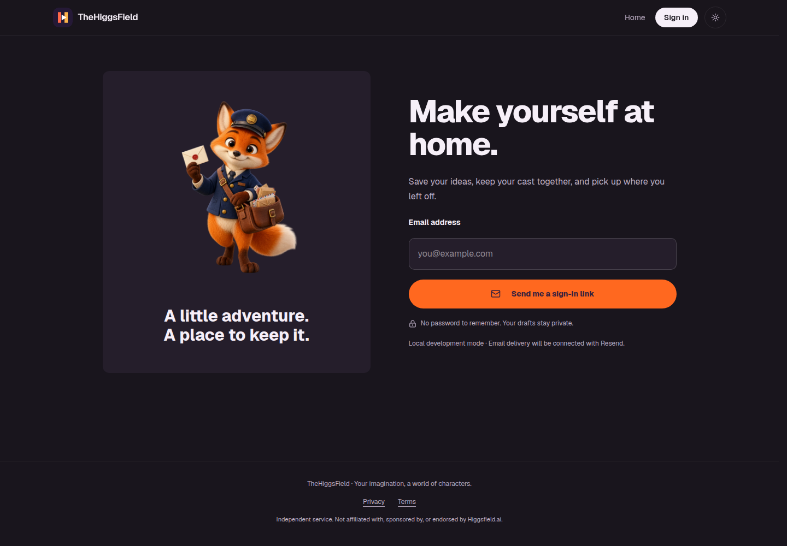

# Install OpenHiggsfield by Transformaiton.com

This guide installs the studio for a local trial and for a self-hosted server. Day-to-day use is in [USAGE.md](USAGE.md). The short version is in the [README](../README.md).

Transformaiton.com is not affiliated with, sponsored by, or endorsed by Higgsfield or Higgsfield.ai.

## What you install

| Requirement | Local trial | Server you expose to others |
| --- | --- | --- |
| [Node.js 24](https://nodejs.org/) or newer | Yes, unless you use only Docker | Yes, unless you use only Docker |
| [FFmpeg](https://ffmpeg.org/) on `PATH` | Yes. The API server uses it to assemble the MP4. | Included in the Docker image. On a Node install, provide it yourself or set `FFMPEG_PATH`. |
| Docker Compose | Optional | The packaged way to run the server |
| [Resend](https://resend.com/) API key and From address | No. `npm run dev` shows the sign-in link on the page. | Yes. The sign-in screen sends email and has no password. |
| fal, Higgsfield, or OpenRouter keys | Only when you render or use the optional writer | Same |
| HTTPS hostname | No. Use `http://127.0.0.1:5193`. | Yes. `PUBLIC_ORIGIN` must be `https://` for any other hostname. |

Confirm Node before installing packages:

```sh
node -v
ffmpeg -version
```

`node -v` should print v24 or newer. If an older Node appears first on your `PATH`, the install warns and you are not on the runtime this release declares.

## Local trial

These commands were run on this repository with Node.js v24.22.3. No provider account was used.

```sh
git clone https://github.com/Transformaiton/OpenHiggsfield.git
cd OpenHiggsfield
npm ci
npm ci --prefix apps/story-studio
npm run dev
```

Leave that terminal open. In a second terminal:

```sh
cd OpenHiggsfield
npm --prefix apps/story-studio run dev
```

Open <http://127.0.0.1:5193>.

What those processes do:

- `npm run dev` starts the API on `127.0.0.1:5194` with test sign-in, open registration, and data under `.studio-data/story-preview/`. That directory is gitignored.
- The second command starts the website on `127.0.0.1:5193` and proxies `/api` to the API.

Sign in with any email address. The page then offers **Open local test sign-in**. The link is shown in the browser. Resend is not called. Test sign-in is refused when `NODE_ENV` is `production` or the host is not `localhost` or `127.0.0.1`.



Stop either process with Ctrl+C. To start clean, stop both processes and remove `.studio-data`. That deletes local accounts, drafts, and any keys you saved there.

## Self-host with Docker

The Compose file publishes the site only on `127.0.0.1:3000`, runs the container read-only, drops capabilities, and stores data in a Docker volume named `studio-data`.

### 1. Get the code

```sh
git clone https://github.com/Transformaiton/OpenHiggsfield.git
cd OpenHiggsfield
```

### 2. Create `.env`

```sh
cp .env.example .env
```

Generate a secret of at least 32 characters and put it in `BETTER_AUTH_SECRET`:

```sh
node -e "console.log(require('node:crypto').randomBytes(48).toString('hex'))"
```

Set the rest for the kind of install you want.

| Variable | Purpose |
| --- | --- |
| `PUBLIC_ORIGIN` | Exact origin users type, such as `http://localhost:3000` or `https://studio.example.com`. Must match the site. HTTPS is required off localhost. |
| `APP_NAME` | Subject line of the sign-in email. The sample is `OpenHiggsfield Story Studio`. |
| `BETTER_AUTH_SECRET` | Session secret. Keep it private. Changing it signs everyone out. |
| `HOST` | Bind address inside the container. The sample is `0.0.0.0`. Compose still publishes only `127.0.0.1` on the host. |
| `PORT` | `3000` |
| `DATA_DIR` | Inside Compose this is forced to `/data`. Leave the sample value for local Node. |
| `STORY_ASSETS` | Built website files. Compose sets this. Leave the sample for a later Node production start. |
| `ALLOW_SIGNUP` | `true` lets any email create an account. `false` uses the invite list. |
| `SIGNUP_EMAILS` | Comma-separated addresses allowed to register when signup is closed. |
| `RESEND_API_KEY` | Resend token for sign-in email. Required on this Docker setup. |
| `EMAIL_FROM` | From address Resend is allowed to use. |
| `GOOGLE_CLIENT_ID` | Read by the server if you set it. |
| `GOOGLE_CLIENT_SECRET` | Read by the server if you set it. |

The story studio sign-in screen in this release only shows the email link. Plan on Resend for a hosted install. The Google variables are accepted by the server and are not presented as a button on that screen.

A single-operator machine at home can use:

```
PUBLIC_ORIGIN=http://localhost:3000
ALLOW_SIGNUP=false
SIGNUP_EMAILS=you@yourbusiness.com
```

Plus `BETTER_AUTH_SECRET`, `RESEND_API_KEY`, and `EMAIL_FROM`.

Open registration is `ALLOW_SIGNUP=true`. Use that only on a server you are prepared to run for strangers. Magic-link requests are limited to 3 per minute per the server rules, and links expire in 10 minutes.

Keep `.env` out of Git. It is gitignored. Do not paste it into a ticket.

### 3. Build and start

```sh
docker compose up --build -d
```

The first build installs dependencies, builds the website, and produces an image based on Node 24 with FFmpeg. Later starts reuse that image until you change the app and build again.

Check the process:

```sh
docker compose ps
curl -fsS http://127.0.0.1:3000/health
```

A healthy API returns `{"ok":true}`. Open <http://localhost:3000>. The server redirects `/` to the studio, which asks you to sign in.

Watch logs:

```sh
docker compose logs -f studio
```

Stop, or stop and remove the container while keeping the volume:

```sh
docker compose stop
docker compose down
```

`docker compose down` does not delete the `studio-data` volume. `docker compose down -v` does. That removes accounts, drafts, films, and the encryption keys.

### 4. Put HTTPS in front

Compose binds `127.0.0.1:3000` so the container is not on the public internet by itself. For a hostname other people use, terminate HTTPS on the host and proxy to that port. Set `PUBLIC_ORIGIN` to the public `https://` origin, then recreate the container so it picks up `.env`:

```sh
docker compose up -d
```

Example Caddy site block, for a domain you control and have pointed at this machine:

```
studio.example.com {
  reverse_proxy 127.0.0.1:3000
}
```

Use your own hostname. Leave <https://transformaiton.com/> on the consultancy site. This repository does not ship that proxy config, and `docs/site/CNAME` still contains `openhiggsfield.com` from the upstream project page. Change the CNAME only when you intend GitHub Pages for this fork to answer on a hostname you control.

### 5. Backups

Provider keys are encrypted in `platform.sqlite` with key files that live in the same data directory (`studio-key-*.key`). Back up the whole directory or the whole Docker volume. A copy of the database without the key files cannot decrypt saved credentials.

```sh
docker volume ls
docker run --rm -v VOLUME_NAME:/data:ro -v "$PWD":/backup alpine \
  tar -C /data -czf /backup/studio-data.tgz .
```

Replace `VOLUME_NAME` with the name from `docker volume ls`. A checkout in a folder named `OpenHiggsfield` usually creates `openhiggsfield_studio-data`. Store the archive somewhere other than the server, and restrict who can read it. It contains customer drafts, films, and the material needed to decrypt API keys.

Run one application process per data directory. Two servers on the same files will corrupt the SQLite database.

### 6. Production without Docker

Build the website, then start the server with the same `.env`:

```sh
npm ci
npm ci --prefix apps/story-studio
npm run build
npm start
```

`npm start` runs `node --env-file=.env deploy/studio/server.mjs`. Provide Node.js 24, FFmpeg, `DATA_DIR`, `STORY_ASSETS=apps/story-studio/dist`, and the variables in the table above. The same HTTPS, backup, and single-process rules apply. This start command does not enable test sign-in.

## Checks that do not spend money

From a Node.js 24 environment, after `npm ci`:

```sh
npm test
```

`npm test` runs the product-auth, vault, and provider-media checks in this repository. They use local fixtures. They do not buy a generation. Further scripts under `scripts/` are part of the upstream test suite; read each file before you run it.

## Project website

`docs/site` is a static page. GitHub Actions in `.github/workflows/pages.yml` publishes it from the `main` branch when files under `docs/` change. The page title and copy in this copy are Transformaiton.com’s. The workflow still deploys with `docs/site/CNAME` set to `openhiggsfield.com`.

## Where to go next

[Use the studio](USAGE.md) after sign-in: cast, script, connections, and render. Questions: <info@transformaiton.com> or <https://transformaiton.com/>.
