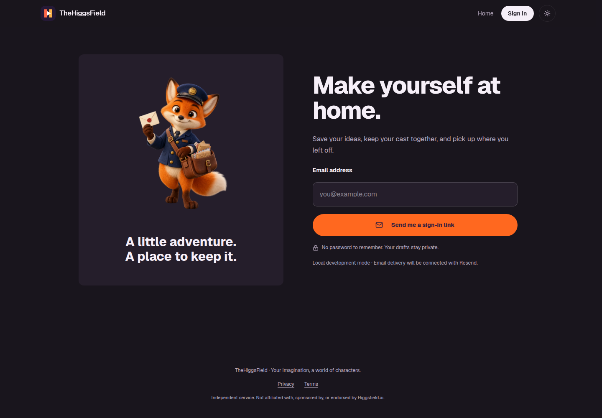
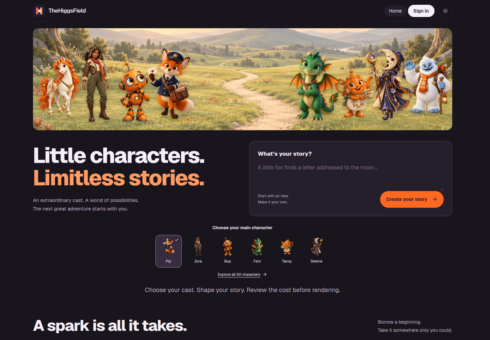
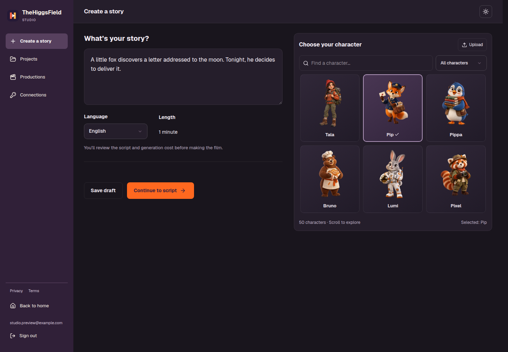
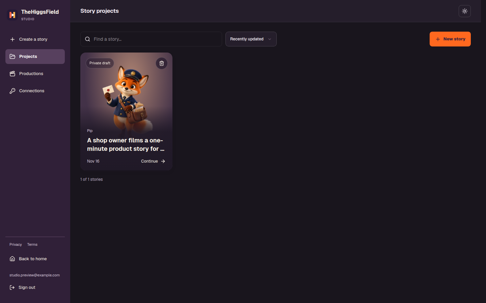
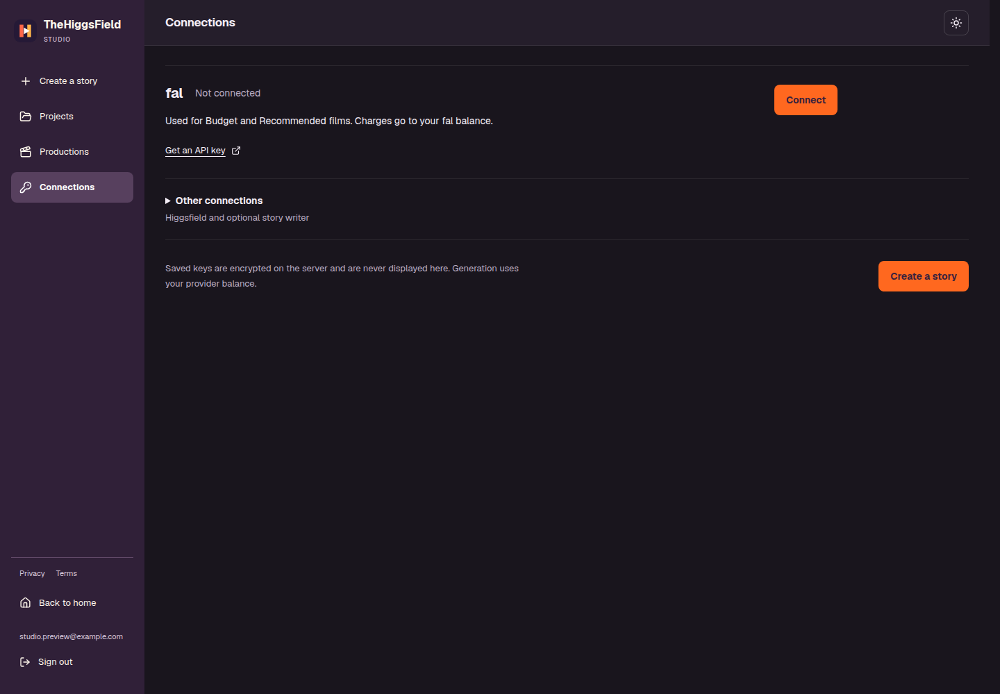

# Use OpenHiggsfield by Transformaiton.com

This is the path through the studio after it is running. Install steps are in [INSTALL.md](INSTALL.md). Costs, the price-check limit, and the relationship to Higgsfield are in the [README](../README.md).

Screenshots are from a local development run on 16 November 2026. The dark theme was the system theme. No fal, Higgsfield, or OpenRouter account was called. The chrome of the app still says TheHiggsField. That is the upstream interface name; this copy’s customer title is OpenHiggsfield by Transformaiton.com.

## Sign in

On a local trial (`npm run dev`), open <http://127.0.0.1:5193>, choose **Sign in**, enter an email, and use the test link the page shows.

On a Docker or other hosted install, enter an email that your `.env` allows. The message arrives from the `EMAIL_FROM` address via Resend. The link works once and expires after 10 minutes. A second request is a new link. The server allows 3 magic-link requests a minute.

There is no password. Session length is 7 days in the server configuration.

## Start a story

The home page lists six starting characters and a prompt. **Create your story** opens the editor with that idea. **Explore all 50 characters** scrolls to the full cast, grouped as Humans, Animals, Robots, Mythical creatures, Talking objects, and Fantasy beings. Search matches name, group, and the short personality line.

A story starter (the colored cards under the prompt) opens the editor with a sample idea you can replace. The film still has to be written and rendered.

## Write and save

The create screen is one minute long. Languages in the menu are English, French, Telugu, Tamil, and Hindi.

1. Write the idea in **What’s your story?** Up to 6,000 characters.
2. Choose a character, or open **Upload** and add a PNG, JPG, or WebP up to 8 MB. Give the upload a name. It is stored on your account.
3. **Save draft** keeps the idea without calling a provider. The address becomes `/create?draft=...`.
4. **Continue to script** saves and opens the six-scene script.

Leaving the page with unsaved edits asks you to stay or discard them. A saved draft appears under **Projects**.

**Delete draft** removes that draft and its saved script after a confirmation. A film you already rendered stays in the library.

## Edit the six scenes

The script screen is one film: a title, a voice direction, and six scenes of 10 seconds. Each scene has **What happens** and **Spoken words**. Keep the spoken line short enough to say in about 9 seconds (the screen says so; the server accepts up to 350 characters and rejects an empty line).

You can edit every field yourself. **Save script** stores that version on the draft.

**Optional AI script writer** calls OpenRouter with Gemini 2.5 Flash and replaces all six scenes. The checkbox is the confirmation that this request may cost money. The button stays off until OpenRouter is connected and the box is checked. Skipping the writer costs nothing.

The side panel shows the character, the selected quality, and the estimated total for six scenes with audio. Open **Change generation option** to switch.

| If the provider is | Options |
| --- | --- |
| fal | Budget (MiniMax H3 Max, 480p), Recommended (MiniMax H3 Max, 768p), Seedance 2.0 (720p) |
| Higgsfield | Seedance 2.0 only |

The estimate in this release is $3.00, $4.80, or $18.14 for those three choices. A new render and a writer request are extra. The panel links to the provider page stored with the estimate. Read [the cost section in the README](../README.md#requirements-and-costs) before you approve one: the server in this release rejects a render when that price check is older than 30 days, and a local run on 16 November 2026 showed “The video price needs to be refreshed before production.”

When a render is allowed, the studio still waits for this confirmation: you reviewed all six scenes, and you agree to send the script and the character image to the selected provider at the estimate on screen. **Generate my film** is unavailable until that box is checked, a key for that provider is saved, and FFmpeg is available.

The finished file is a 720p MP4, 16:9. Audio comes from the video model. The same voice direction is sent with every scene. Listen to the result before you use it in an ad. The model can miss a word or change a face.

## Connect a provider

**Connections** is in the studio sidebar.

1. Create a key at the provider. fal: <https://fal.ai/dashboard/keys>. Higgsfield: <https://console.higgsfield.ai>. OpenRouter, only if you want the writer: <https://openrouter.ai/settings/keys>.
2. In the studio, choose **Connect** on fal, or open **Other connections** for Higgsfield and the story writer.
3. Paste the key and save. Higgsfield asks for an API key ID and a secret. You can paste them as `key-id:key-secret` in the key field, or use the separate secret field.
4. The page then says the key is saved. It does not display the secret again, and it does not prove the key can call a model. That check happens when you generate.

Keys are encrypted in the data directory. Removing a connection in the studio deletes the stored secret. It does not close the provider account or refund a charge that already happened.

Do not put keys in the frontend source, in Git, in `.env` (those files are for the studio’s own sign-in settings), or in an email to Transformaiton.com.

## While a film renders

The production view polls the job. Scenes move through queued, starting, rendering, saving, and ready. The server allows one active production per workspace, and 20 productions stored per workspace.

**Stop this production** blocks further submissions from this studio. A clip the provider has already accepted can still finish and appear on that provider’s bill.

If a scene is marked uncertain, the form asks for the request UUID from the provider’s history. **Recover existing request** attaches that job. It does not submit a new one. **Continue from saved progress** is for a film that failed during assembly after the clips were saved, or for a similar resumable state. The button is withheld while a scene is still uncertain, failed, or submitting.

**Download film** saves the MP4. The download name in the server response is `TheHiggsField-story.mp4`.

Closing the tab does not cancel a provider job that was already submitted.

## Languages, length, and what this studio will not do

- Length is one minute. The create screen labels it **1 minute**, and the script is six scenes of 10 seconds.
- Story languages are English, French, Hindi, Tamil, and Telugu. The menus and buttons of the studio are English.
- Output is a 720p 16:9 MP4. There is no 9:16 export in this story flow, and there is no direct post to Instagram, TikTok, YouTube, or a paid ads account.
- The included cast is illustrated characters shipped with the project. Uploading a photo sends that image to the provider you approve. You need the right to use it. The result can still differ from the reference.
- Share links and a public gallery are not a complete publishing workflow in this release. Download the file and place it where your audience is.

## Privacy on your installation

Drafts, uploads, and renders are stored for the signed-in workspace. Generating sends the prompt, script, and character image the provider needs, together with the saved credential, to that provider. Their terms cover that processing.

The privacy and terms pages linked from the studio still describe the upstream hosted service, including a contact form and a waitlist this release’s screens do not implement. `/contact` is not a separate page here. Before customers use a public server, replace those pages with text that matches your host, your retention, and a contact address you actually answer.

For questions about Transformaiton.com’s copy of the project, email <info@transformaiton.com>. Do not include API keys or sign-in links.

## When something fails

| What you see | What to do |
| --- | --- |
| The account server is unavailable | The website is up and the API is not. Start `npm run dev`, or `docker compose ps` and the logs. `curl -fsS http://127.0.0.1:3000/health` should return `{"ok":true}` on Docker. |
| Email sign-in is not configured | Set `RESEND_API_KEY` and `EMAIL_FROM`, or use the local test server. |
| That link has expired or has already been used | Request a new link. Each link is single-use and lasts 10 minutes. |
| This installation is invitation only | Add the email to `SIGNUP_EMAILS` or set `ALLOW_SIGNUP=true`, then recreate the container if you use Docker. |
| Authentication requires an HTTPS origin | `PUBLIC_ORIGIN` must be `https://` unless the host is `localhost` or `127.0.0.1`. |
| The video price needs to be refreshed before production | The built-in price check is older than 30 days, so rendering is refused. Drafts still save. See the README. |
| Connect fal / Connect Higgsfield | That provider’s key is not saved yet. |
| Finish the narration in every scene before generating | A scene still has placeholder wording or an empty spoken line. |
| Film assembly is unavailable | Install FFmpeg or set `FFMPEG_PATH`. Recreate the Docker container if the image failed to install it. |
| Finish or resolve the current production before starting another | One active film per workspace. Stop it, recover it, or wait until it completes. |
| This preview supports 20 productions per workspace | Delete is not offered for finished films in the projects list. Archive or move the data directory if you have hit the cap and need a new workspace. |
| Draft changed. Reload before saving the script. | The draft was saved elsewhere. Reload so you do not overwrite it. |
| Choose a PNG, JPG or WebP image smaller than 8 MB | The upload was the wrong type or too large. |

If the failure is in this Transformaiton.com copy and the table does not cover it, write to <info@transformaiton.com> with the on-screen message and the step you were on. Leave out secrets.
